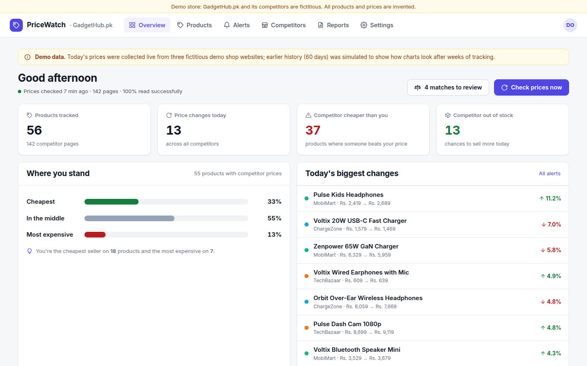
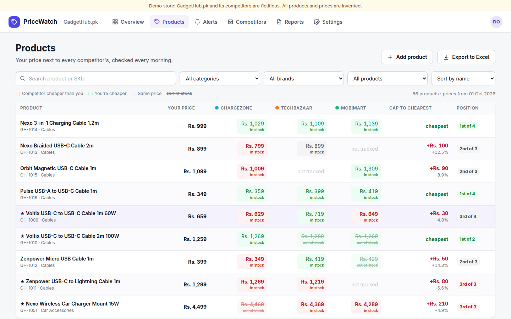
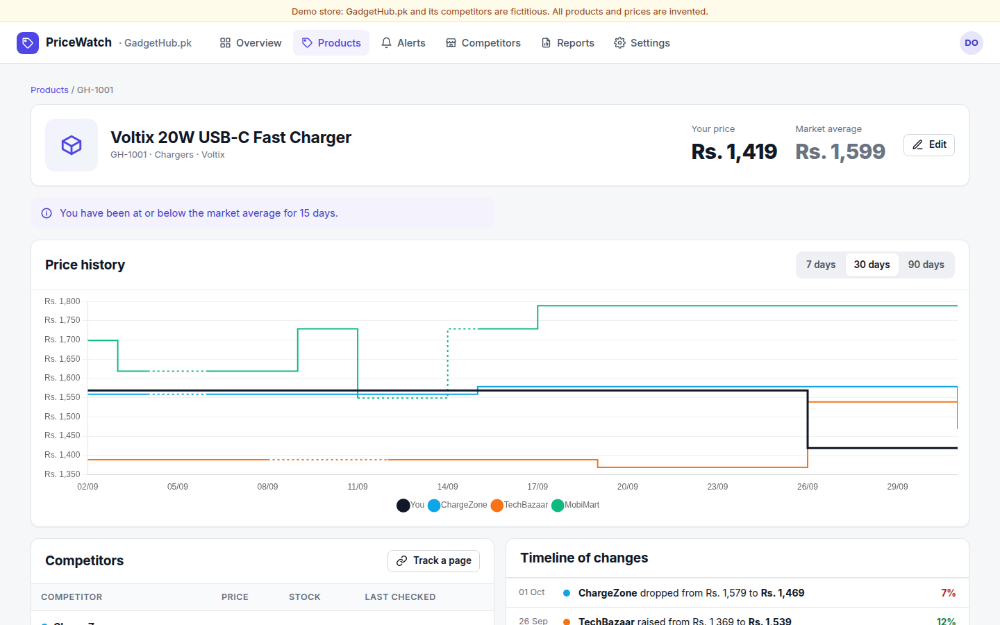
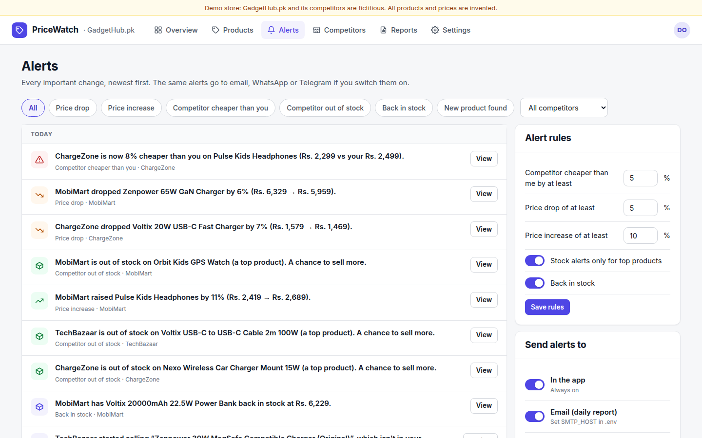
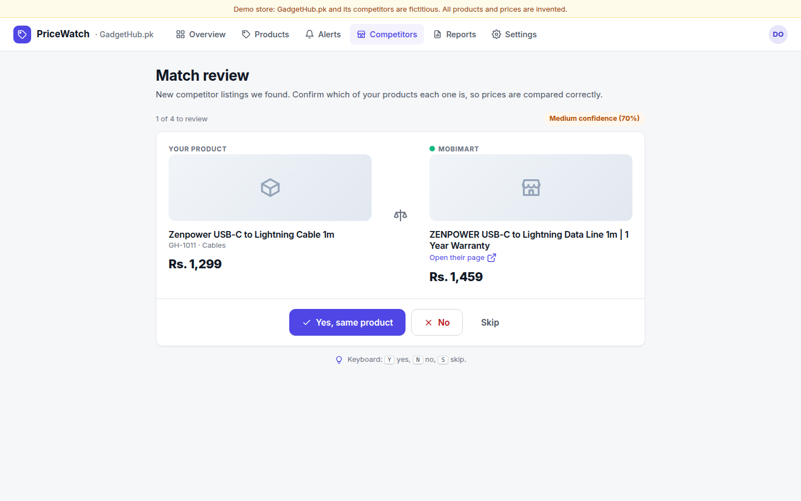
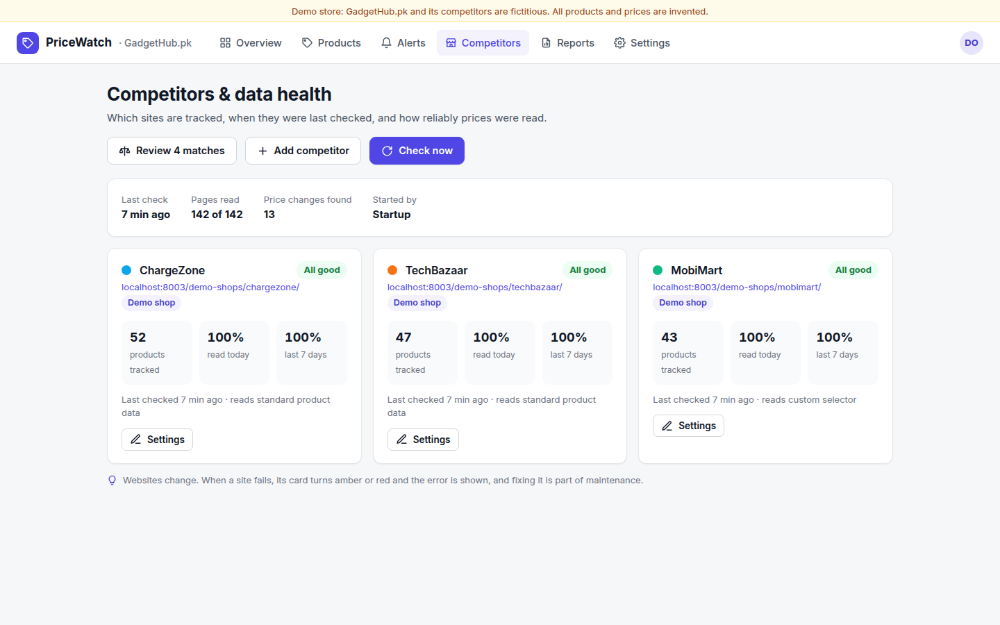
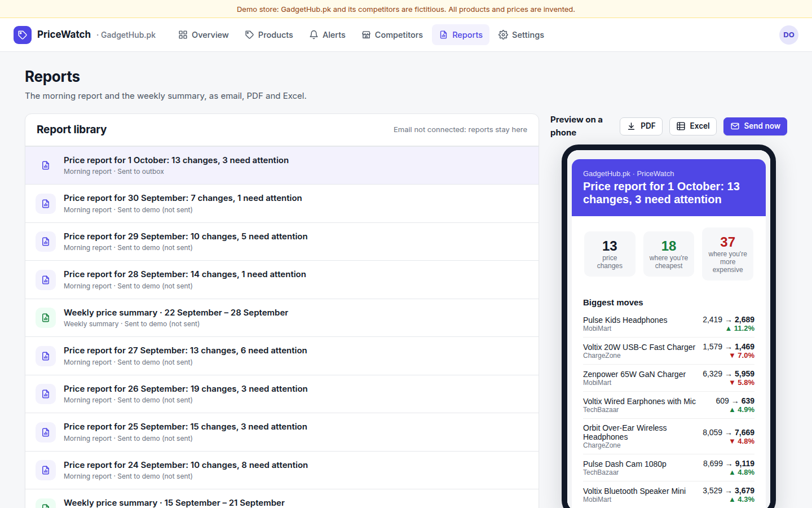
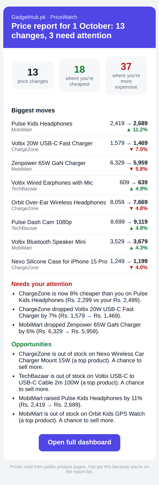
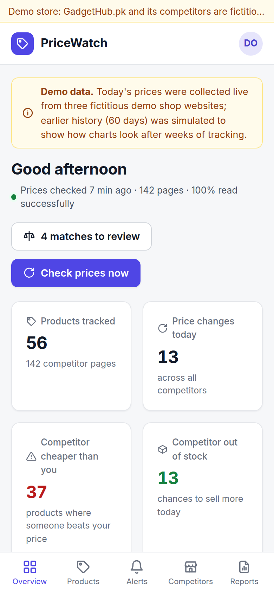

# PriceWatch: Competitor Price Monitor

**Know every time a competitor changes their price, without checking a single website.**

PriceWatch visits competitor product pages every morning, records prices and stock, compares them with yours, and gives the client a dashboard, alerts and a short morning report.



## What it does

| | |
|---|---|
| **Daily collection** | Reads public product pages once a day, politely (1.5 s between pages per site, identifies itself, respects `robots.txt`) |
| **Works on most stores without setup** | Reads standard product data (schema.org JSON-LD, microdata, product meta tags); custom CSS selectors for sites without it |
| **Overview** | Products tracked, changes today, where a competitor is cheaper, competitor stock-outs; "where you stand" bars; biggest changes; 30-day trend vs. market |
| **Products table** | Your price next to each competitor, coloured (red = they're cheaper), stock, gap to cheapest, position (1st of 4…), filters, sort by gap, Excel export |
| **Product detail** | Price history chart (7/30/90 days), competitor table with links and last-checked time, timeline of every change, insight sentence, "matching the lowest price would cost Rs. X" |
| **Alerts** | Price drop, price increase, competitor cheaper than you, out of stock, back in stock, new product found; rules per client; delivered in-app, by email, WhatsApp or Telegram |
| **Match review** | New competitor listings are matched to your products automatically (High / Medium confidence); a person confirms with Yes / No / Skip |
| **Data health** | Per competitor: products tracked, success rate today and last 7 days, last check, errors |
| **Reports** | Morning email (phone-friendly) and weekly summary (most aggressive competitor, positions gained/lost), each also as PDF and Excel |
| **Team & branding** | Admin / analyst / viewer roles, CSV product import, logo and colour |

## Screens

| Overview | Products | Product detail |
|---|---|---|
|  |  |  |
| **Alerts & rules** | **Match review** | **Data health** |
|  |  |  |
| **Reports** | **Morning email (phone)** | **Mobile overview** |
|  |  |  |

## The demo store (and what's real)

The demo is a fictitious mobile-accessories shop, **GadgetHub.pk** (56 products), watched against three **fictitious** competitor websites that the app itself serves at `/demo-shops/...`:

| Demo competitor | How its pages publish prices | What it shows off |
|---|---|---|
| ChargeZone | schema.org JSON-LD | the most common format on Shopify/WooCommerce stores |
| TechBazaar | schema.org microdata | a price war (12 products undercut for a week), a new product appearing |
| MobiMart | plain HTML, no structured data | custom CSS selector, frequent stock-outs, a weekend sale, listings needing match review |

- **Today's prices are collected live** over HTTP by the real collector, exactly as it would read a real store.
- **The 60 days before today are simulated** with the same price model, so charts have shape on day one. This is labelled in the app. The MD plan says to collect 3-4 weeks of real history before demos: start tracking real competitors early.
- The collector was also tested on books.toscrape.com (a public site made for scraping practice): price, stock and title read correctly.

## Measured results

From `scripts/evaluate.py` on the demo store (details: [docs/results.md](docs/results.md)):

| | |
|---|---|
| Live prices read exactly right | **142 of 142** (stock status 100%) |
| Pages read successfully | 100% |
| Full check of 142 pages | ~5 s (demo shops; real sites are read 1.5 s apart per site) |
| Competitor price changes caught in a week | 91 |
| Example insight | "MobiMart cut prices on 43 of your products in one week" (its weekend sale) |
| Manual checking avoided | ~12 hours per week (at 45 s per page) |

For a real client, spot-check 20 products by hand against the dashboard before the first demo.

## Quick start

```bash
./run.sh
```
Open http://localhost:8003 and click **View demo store** (the demo store is created on first start, ~10 seconds).

- Demo login: `demo@pricewatch.app` / `demo1234`
- Landing page: http://localhost:8003/landing · Data sources & privacy: http://localhost:8003/privacy
- No API key needed. Email/WhatsApp/Telegram are optional (see `.env.example`); without email settings, reports stay in the app's Reports library.

## Setting up a real client

1. **Products**: Settings → Products & import → upload their CSV (`sku, name, price, brand, category, cost, top`).
2. **Competitors**: Competitors → Add competitor. Set the catalogue page so new listings show up in **Match review**. Add a price selector only if the site has no standard product data.
3. **Pages**: for each product, Products → product → **Track a page** (the page is read once immediately, so you see straight away if it works). Or confirm suggestions in Match review.
4. **Rules and delivery**: Alerts → rules; set SMTP / WhatsApp / Telegram in `.env`.
5. **Schedule**: Reports → check time, report time, recipients, weekly day.
6. **Without the demo**: on a fresh `data/` folder set `DEMO_MODE=0`, `ADMIN_EMAIL` and `ADMIN_PASSWORD` in `.env`; the app starts empty with that admin account.

(Do steps 1-5 after step 6 for a real install.)

## Free live demo on Hugging Face Spaces

No card needed. The demo data rebuilds itself on every start, so the link always shows a clean demo.

1. Create a free account at https://huggingface.co and a token with **Write** access at https://huggingface.co/settings/tokens.
2. Put optional secrets in `.env` (`SMTP_*` / `TELEGRAM_BOT_TOKEN` (optional, report and alert delivery), `CONTACT_EMAIL` / `CONTACT_WHATSAPP`). They are stored as Space secrets, never in the code.
3. Run:
   ```bash
   pip install huggingface_hub
   python scripts/deploy_hf.py --user YOUR_HF_USERNAME --token hf_xxx
   ```
4. Wait for the first build (a few minutes). Your link: `https://YOUR_HF_USERNAME-pricewatch.hf.space`

Free Spaces sleep after about 2 days without visitors; open the link a minute before a client meeting to wake it up.

## Deploying

```bash
docker build -t pricewatch .
docker run -p 8003:8003 -v $(pwd)/data:/app/data --env-file .env pricewatch
```
Keep it running: the built-in scheduler checks prices daily at the set time and sends reports. Set `PUBLIC_BASE_URL` so links in emails work.

## Project structure

```
app/
  main.py        Routes, auth, scheduler, the fictitious demo shops
  collector.py   Polite fetching (robots.txt, delays), price/stock parsing (JSON-LD, microdata, meta, selectors), discovery
  matching.py    Name matching with brand + spec numbers (20W ≠ 33W, 1m ≠ 2m)
  analytics.py   Snapshots, positions, trends, product detail, data health
  alerts.py      Rules → alerts
  reports.py     Morning report / weekly summary as HTML email, PDF, Excel
  notify.py      Email (SMTP), Telegram, WhatsApp
  demo.py, seed.py  Demo store, demo competitors, price simulation, back-filled history
static/          Single-page app, landing page, privacy page
scripts/         evaluate.py, record_demo.py
docs/            Case study, pitch, demo script, one-pager, pricing, onboarding, sample reports, results, screenshots, demo video
```

## Client materials (in `docs/`)

[Demo video](docs/demo.mp4) · [One-page PDF](docs/one-pager.pdf) · [Case study](docs/case-study.md) · [Pitch & outreach](docs/pitch-and-outreach.md) · [Demo script](docs/demo-video-script.md) · [Pricing](docs/pricing.md) · [Onboarding & maintenance](docs/onboarding-and-handover.md) · [Sample weekly report PDF](docs/sample_weekly_report.pdf) · [Sample morning report PDF](docs/sample_daily_report.pdf) · [Results](docs/results.md)

## Honest limits (tell clients upfront)

- Websites can change or block automated visitors; the data-health page shows it the same day and repairs are part of the service.
- Variants and bundles need a one-time manual match check.
- Flash-sale prices can change within a day; a daily check shows the daily picture.
- It informs pricing decisions; the client decides what to do. For important contracts, get legal advice on scraping rules in their market.
